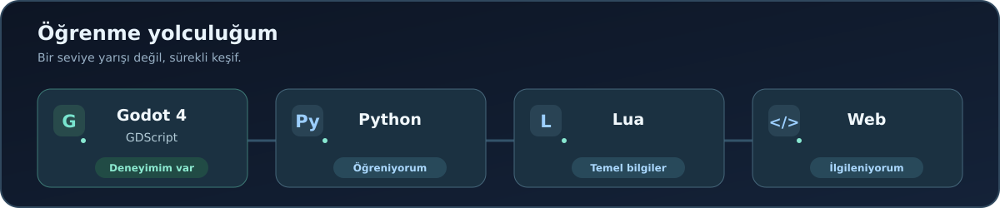
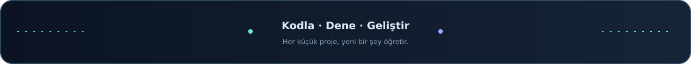

  

  
<strong>🎮 Oyun geliştirme &nbsp;·&nbsp; 🌐 Web geliştirme &nbsp;·&nbsp; 🛠️ Hobi projeleri</strong>

## 👋 Biraz benden

Merhaba, ben **Görkem Çalışkan**! Yazılım geliştirmeyi merak ederek öğrenen, aklına gelen fikirleri küçük projelere dönüştürmeyi seven biriyim. Özellikle **oyun geliştirme** ve **web geliştirme** ile ilgileniyorum.

**Godot 4 ve GDScript** ile deneyimim var. Şu sıralar **Python** öğreniyorum; **Lua** hakkında da temel bilgilere sahibim. Farklı dilleri ve teknolojileri keşfederek kendimi geliştirmeye çalışıyorum.

Projelerimin çoğu hobi amaçlı. Geliştirirken **yapay zekâdan da destek alıyorum**, ama asıl hedefim kullandığım kodu daha iyi anlamak ve zamanla daha çok şeyi kendi başıma yapabilmek.

## 🧭 Öğrenme yolculuğum

  

## ✨ İlgilendiğim şeyler

| Alan | Neler yapıyorum? |
| --- | --- |
| 🎮 **Oyun geliştirme** | Godot 4 ile prototipler, mekanik denemeleri ve küçük oyun fikirleri |
| 🌐 **Web geliştirme** | Web arayüzleri, kişisel siteler ve statik site araçları |
| ⚙️ **Araçlar & otomasyon** | Python'la küçük yardımcı araçlar ve denemeler |
| 📱 **Yeni teknolojiler** | Android uygulamaları ve farklı dilleri keşfetme |

## 🛠️ Araç kutum

  

> **Küçük bir not:** Bu teknolojilerde aynı seviyede değilim. Godot 4 / GDScript tarafında daha fazla deneyimim var; diğerlerini öğreniyor veya keşfediyorum.

## 🎯 Hedefim

Kendi başıma daha iyi kod yazabilmek, bir projenin yalnızca **nasıl** değil **neden** çalıştığını da kavramak ve her yeni denemede biraz daha ilerlemek.

  

